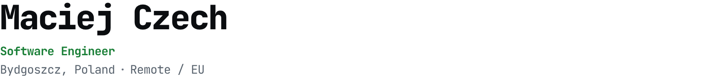
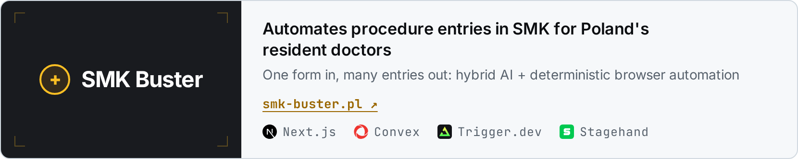
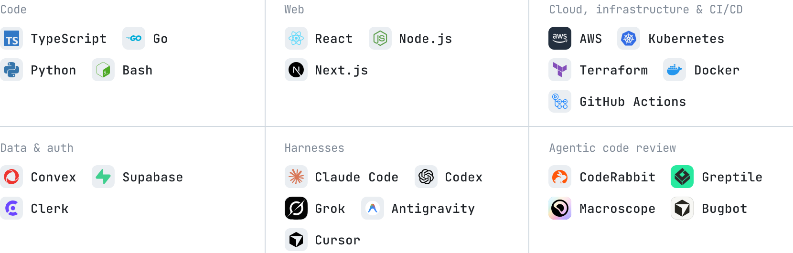

<!-- Images in assets/ are generated: npm run build:assets -->

<picture>
  <source media="(max-width: 767px) and (prefers-color-scheme: dark)" srcset="assets/wordmark-narrow-dark.png">
  <source media="(max-width: 767px)" srcset="assets/wordmark-narrow-light.png">
  <source media="(prefers-color-scheme: dark)" srcset="assets/wordmark-wide-dark.png">
  
</picture>

I work on User Foundation (login, privacy, and consents) at Schibsted. Outside work I build and run MatchPlay for pickup sports and SMK Buster for resident doctors.

<a href="https://matchplay.gg">
<picture>
  <source media="(max-width: 767px) and (prefers-color-scheme: dark)" srcset="assets/matchplay-narrow-dark.png">
  <source media="(max-width: 767px)" srcset="assets/matchplay-narrow-light.png">
  <source media="(prefers-color-scheme: dark)" srcset="assets/matchplay-wide-dark.png">
  
</picture>
</a>

<a href="https://smk-buster.pl">
<picture>
  <source media="(max-width: 767px) and (prefers-color-scheme: dark)" srcset="assets/smk-buster-narrow-dark.png">
  <source media="(max-width: 767px)" srcset="assets/smk-buster-narrow-light.png">
  <source media="(prefers-color-scheme: dark)" srcset="assets/smk-buster-wide-dark.png">
  
</picture>
</a>

## How I work

For personal projects, I steer agents on two remote Linux machines of my own through T3 Code from any device. Claude Code splits and builds the work, Codex reviews, Grok researches, and Neon (Gemini) edits text. Every PR arrives with screenshots and test output, merges itself when checks leave no doubt, and waits for me otherwise. That merged ~970 PRs across 6 repos in a month. Locally I work on macOS, and Claude Design is my design tool.

## Stack

<picture>
  <source media="(max-width: 767px) and (prefers-color-scheme: dark)" srcset="assets/stack-narrow-dark.png">
  <source media="(max-width: 767px)" srcset="assets/stack-narrow-light.png">
  <source media="(prefers-color-scheme: dark)" srcset="assets/stack-wide-dark.png">
  
</picture>

[LinkedIn](https://www.linkedin.com/in/maciej-czech) · [maciej.a.czech@gmail.com](mailto:maciej.a.czech@gmail.com)
