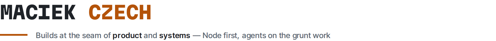
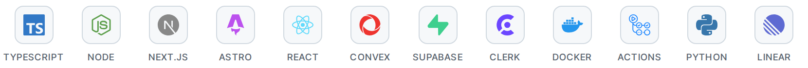
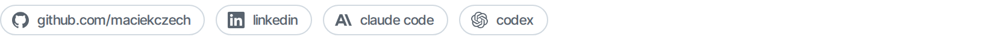

<!-- Everything visual here is generated and committed, not fetched from a third party.
     Regenerate:  node tools/build-assets.mjs   (wordmark, stack, links)
                  node tools/pipeline.mjs       (animated pipeline)
                  node tools/metrics.mjs --write (language bars)
     Why images: GitHub strips <style>, class and script from READMEs. An image is the
     only surface you actually control — and a self-hosted one can't 503 on you. -->

<picture>
  <source media="(prefers-color-scheme: dark)" srcset="assets/wordmark-dark.png">
  
</picture>

<picture>
  <source media="(prefers-color-scheme: dark)" srcset="assets/stack-dark.png">
  
</picture>

**Now** — [t3code](https://github.com/maciekczech/t3code) agent orchestrator&nbsp; ·&nbsp; [tariff-radar](https://github.com/maciekczech/tariff-radar) trade-remedy signals&nbsp; ·&nbsp; [hermes-agent](https://github.com/maciekczech/hermes-agent) grows with you

<picture>
  <source media="(prefers-color-scheme: dark)" srcset="assets/pipeline-dark.svg">
  
</picture>

**Where the work goes** — 45 repos by primary language, 13 of them in the open

```text
TypeScript         16 repos  ███████████·············   45.7 %
Python              7 repos  █████···················   20.0 %
JavaScript          6 repos  ████····················   17.1 %
Shell               2 repos  █·······················    5.7 %
Rust, HTML, other   4 repos  ███·····················   11.4 %
```

<picture>
  <source media="(prefers-color-scheme: dark)" srcset="assets/links-dark.png">
  
</picture>
