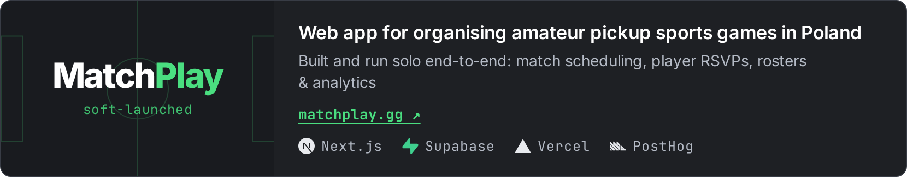

<!-- Images in assets/ are generated: npm run build:assets.
     Theme: GitHub hides a link whose href, or an image whose src, ends in #gh-dark-mode-only or #gh-light-mode-only.
     A <source> that mentions prefers-color-scheme loses its width condition under a fixed GitHub theme. -->

<a href="assets/board-wide-dark.png#gh-dark-mode-only"><picture>
  <source media="(max-width: 1011px)" srcset="assets/board-narrow-dark.png" width="400">
  
</picture></a>
<a href="assets/board-wide-light.png#gh-light-mode-only"><picture>
  <source media="(max-width: 1011px)" srcset="assets/board-narrow-light.png" width="400">
  
</picture></a>

<a href="https://matchplay.gg/#gh-dark-mode-only"><picture>
  <source media="(max-width: 1011px)" srcset="assets/matchplay-narrow-dark.png" width="400">
  
</picture></a>
<a href="https://matchplay.gg/#gh-light-mode-only"><picture>
  <source media="(max-width: 1011px)" srcset="assets/matchplay-narrow-light.png" width="400">
  
</picture></a>
<a href="https://smk-buster.pl/#gh-dark-mode-only"><picture>
  <source media="(max-width: 1011px)" srcset="assets/smk-buster-narrow-dark.png" width="400">
  
</picture></a>
<a href="https://smk-buster.pl/#gh-light-mode-only"><picture>
  <source media="(max-width: 1011px)" srcset="assets/smk-buster-narrow-light.png" width="400">
  
</picture></a>

